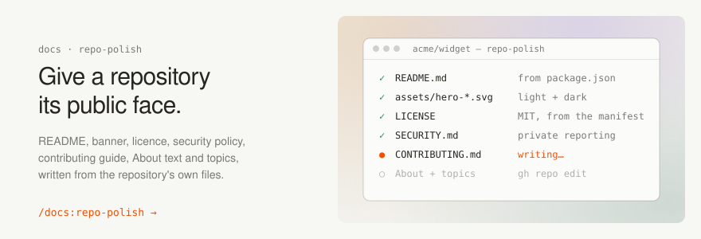

# Published skills

<picture>
  <source media="(prefers-color-scheme: dark)" srcset="../assets/hero-dark.svg">
  
</picture>

Only release-ready, recursively discoverable skills belong in this directory.

- [repo-polish](repo-polish/SKILL.md) — builds a repository's public face against the house style, from what the repository's own files say: README, banner, `LICENSE`, `SECURITY.md`, `CONTRIBUTING.md`, the forge's description, and its topics.

This plugin has no `shared/` directory yet. Add one when a second skill needs the same concrete rules; a single skill does not need the indirection.
